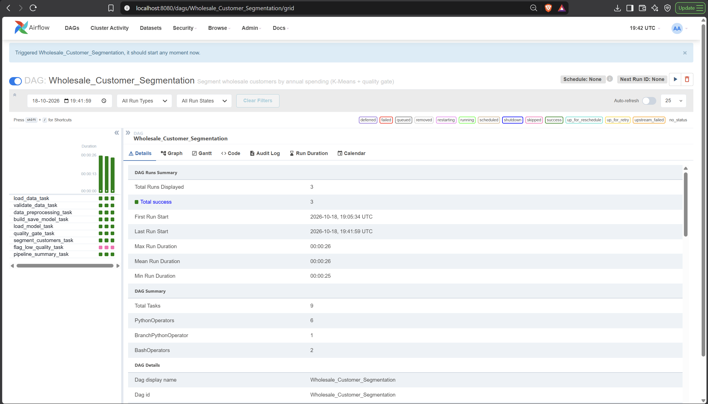
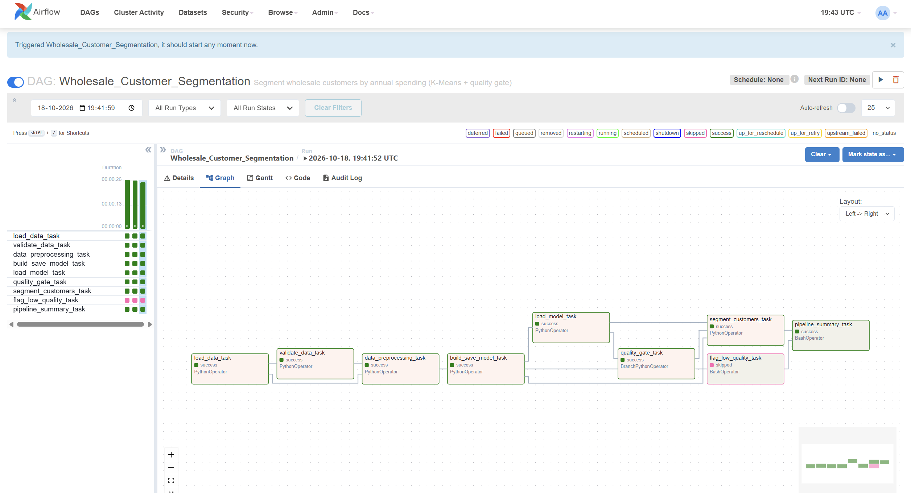
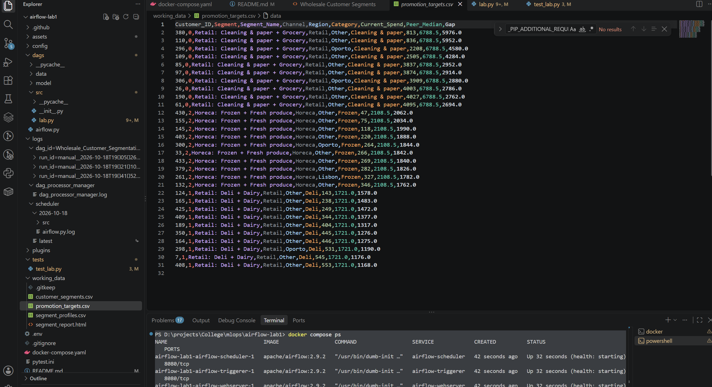
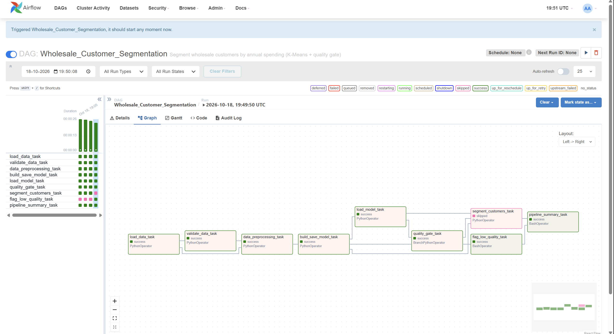

# MLOps Airflow Lab 1 – Wholesale Customer Segmentation


**Author:** Sushant M · IE-7374 MLOps, Northeastern University (Boston)

Modified version of **Airflow_Labs/Lab_1** from Prof. Ramin Mohammadi's MLOps course. Apache Airflow 2.9.2 runs
in Docker and orchestrates a K-Means clustering pipeline, now applied to a real business problem.

## Real-world scenario

A food wholesale distributor in Portugal sells to 440 hotels, restaurants, cafés and shops. The sales team
wants to group these customers by **what they buy** so they can plan targeted promotions and delivery
schedules, for example fresh-produce deals for restaurants and bulk grocery deals for shops.

This pipeline finds those customer segments, names them in plain language (e.g. *"Retail: Grocery + Cleaning &
paper"*), and answers the questions a sales team actually asks:

- **Which segment matters most?** Revenue and share of revenue per segment, next to its share of customers.
- **Where can we grow?** Customers who spend less than their peers on their segment's signature category
  probably buy it from a competitor. Peers are customers in the same segment *and* the same channel, so
  restaurants are only compared with restaurants and shops with shops. The pipeline adds up that gap as a
  growth opportunity per segment.
- **Who do we call first?** `promotion_targets.csv` lists the customers with the biggest gap in each segment.

The report is only published if the segments pass a quality check.

## What I changed from the original lab

| Area | Original lab | This repo |
| --- | --- | --- |
| Dataset | `file.csv` (credit-card data) | UCI **Wholesale Customers**: annual spending of 440 businesses on 6 product categories |
| Data validation | none | `validate_data_task` stops the run if columns are missing, values are null or negative, or there are too few rows |
| Preprocessing | basic scaling of the raw values | **log transform** (spending is heavily skewed by a few big customers) + standard scaling |
| Model quality | elbow method only | elbow method chooses k; **silhouette score** checks how well separated the segments are |
| Quality gate | none | `BranchPythonOperator` publishes segments only if silhouette ≥ threshold; otherwise a warning task runs instead |
| Output | optimal k in the task log | named segments, `customer_segments.csv`, `segment_profiles.csv`, and an **HTML report with charts** |
| Business value | none | revenue share per segment, **share-of-wallet growth opportunity**, and a ranked **call list** (`promotion_targets.csv`) |
| Run settings | hard-coded | DAG **Params** `max_k` and `min_silhouette`, editable when triggering |
| Tasks | 4, in a straight line | 9, with a branch and a join (`trigger_rule="none_failed_min_one_success"`) |
| Code | deprecated `python_operator` import, `schedule_interval`, XCom pickling setting | current imports, `schedule`, `with DAG(...)`, base64 XCom values (no pickling setting needed) |
| Testing | none | 16 pytest tests + GitHub Actions (flake8, 85% coverage minimum) |

## Pipeline

```
load_data → validate_data → data_preprocessing → build_save_model → load_model (elbow)
    → quality_gate ─┬─ pass → segment_customers ─┬─→ pipeline_summary
                    └─ fail → flag_low_quality ──┘
```

| Task | What it does |
| --- | --- |
| `load_data_task` | Reads `wholesale_customers.csv` |
| `validate_data_task` | Data contract checks; fails the run on bad input |
| `data_preprocessing_task` | Log-transforms and standardizes the 6 spending columns |
| `build_save_model_task` | Fits K-Means for k = 1…`max_k`, records SSE and silhouette, saves `model.sav` |
| `load_model_task` | Chooses k with the elbow method (`kneed`) |
| `quality_gate_task` | Branches on the silhouette score at the chosen k |
| `segment_customers_task` | Names the segments, sizes revenue and growth opportunity, writes the CSVs, call list and HTML report |
| `flag_low_quality_task` | Logs a warning instead of publishing |
| `pipeline_summary_task` | Runs after either branch and lists the output files |

## Results

Run on the full UCI dataset (440 customers, annual revenue 14,619,500 m.u.). The elbow method chose
**3 segments** with a silhouette score of **0.26**, so the quality gate passed and the report was published.

| Segment | Customers | Revenue share | Avg spend | Signature category | Growth opportunity |
| --- | --- | --- | --- | --- | --- |
| Retail: Cleaning & paper + Grocery | 80 (18.2%) | 16.2% | 29,548 | Cleaning & paper | 57,216 |
| Retail: Deli + Dairy | 147 (33.4%) | **53.2%** | 52,903 | Deli | 32,855 |
| Horeca: Frozen + Fresh produce | 213 (48.4%) | 30.6% | 21,028 | Frozen | **114,958** |

**Takeaways for the sales team**

- *Retail: Deli + Dairy* is a third of the customers but more than half of the revenue, so it is the segment to protect.
- *Horeca: Frozen + Fresh produce* is the largest group but spends the least per customer. 105 of these
  restaurants and cafés buy less frozen food than their peers, worth about 115k m.u. a year if they caught up
  to the peer median. This is the biggest growth opportunity.
- Across all segments, the total growth opportunity is about **205k m.u. a year** (1.4% of current revenue).
- `promotion_targets.csv` lists the specific customers to contact first in each segment.

### Pipeline run

All tasks succeeded. `flag_low_quality_task` is skipped (pink) because the quality gate passed.



### Segment report

`working_data/segment_report.html`, generated by `segment_customers_task`:



### Promotion call list

Top rows of `working_data/promotion_targets.csv`:



### Quality gate in action

Triggering the DAG with `min_silhouette = 0.9` makes the gate fail: `segment_customers_task` is skipped and
`flag_low_quality_task` runs instead, so a poor segmentation never reaches the sales team.



## Project structure

```
.
├── .github/workflows/test_pipeline.yml
├── dags/
│   ├── data/wholesale_customers.csv   # UCI Wholesale Customers dataset
│   ├── model/                         # model.sav is written here
│   ├── src/
│   │   ├── __init__.py
│   │   └── lab.py                     # pipeline functions + HTML report
│   └── airflow.py                     # DAG: Wholesale_Customer_Segmentation
├── tests/test_lab.py
├── assets/                            # screenshots used in this README
├── working_data/                      # segment CSVs, promotion_targets.csv, segment_report.html
├── docker-compose.yaml              # Airflow 2.9.2 official file + 4 edits
├── .env
├── pytest.ini
└── requirements-dev.txt
```

## How to run (Windows, PowerShell)

Requires Docker Desktop running with at least 4 GB memory. The dataset and the edited
`docker-compose.yaml` are already in the repo.

```powershell
git clone https://github.com/sushantm47/airflow-sim.git
cd airflow-sim
mkdir logs, plugins, config
docker compose up airflow-init
docker compose up
```

Open http://localhost:8080 (login `airflow` / `airflow`), switch on **Wholesale_Customer_Segmentation**,
and trigger it. Open `working_data/segment_report.html` in a browser to see the report.
Stop with `docker compose down`.

### Changes made to Airflow's official `docker-compose.yaml` (2.9.2)

- `AIRFLOW__CORE__LOAD_EXAMPLES` set to `'false'`
- `_PIP_ADDITIONAL_REQUIREMENTS` set to `pandas scikit-learn kneed matplotlib`
- added the volume `${AIRFLOW_PROJ_DIR:-.}/working_data:/opt/airflow/working_data`
- `airflow-init` also creates `working_data/` and gives the Airflow user write access to it

## Running the tests (no Docker needed)

```powershell
python -m venv .venv
.venv\Scripts\Activate.ps1
pip install -r requirements-dev.txt
pytest --cov=src
```

The tests use a small synthetic customer table with the same columns, so they don't need the downloaded file.

## Data source

Cardoso, M. (2013). *Wholesale customers* [Dataset]. UCI Machine Learning Repository.
https://doi.org/10.24432/C5030X. Licensed CC BY 4.0.